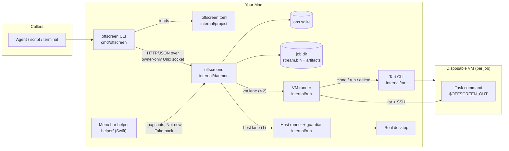
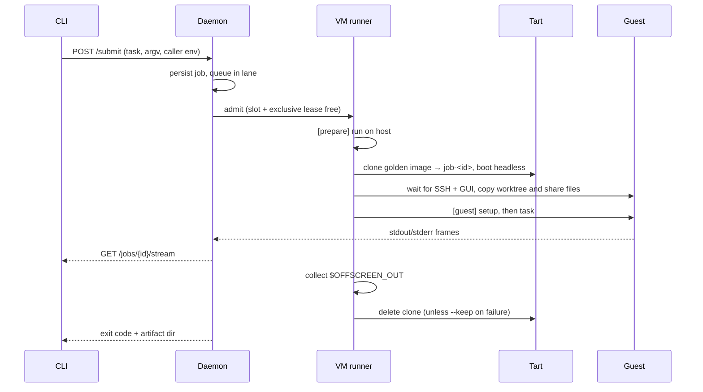
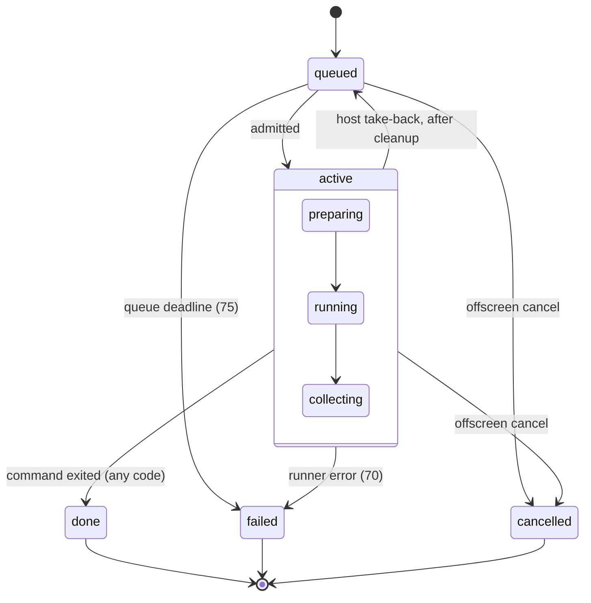

# Architecture

## Components

`offscreen image build` runs in the CLI, not the daemon. It clones the base image with Tart, checks the guest's GUI session, and records the result as `current_image` in the user config. Older images stay in Tart until `offscreen image prune` deletes them. It only selects names `image build` produces, always keeps `current_image` (and refuses if Tart doesn't list it), skips running images, and refuses `--yes` while a VM job is past the queue (it proceeds if the daemon is not running). A lock file beside the config serializes prune against `image build` publishing a new image.

## Job lifecycle (VM lane)

The host lane follows the same flow without Tart. The task runs in the real checkout under a guardian process, and `[guest] setup` is skipped. Admission waits for fresh helper observations: idle long enough, unlocked and awake, camera and mic off, and not paused. A ten-second countdown comes first.

## Job states

A failing test ends as `done` with the test's exit code. `failed` means offscreen itself could not run or clean up the job.

## Admission rules

| Rule | Where |
| --- | --- |
| VM lane: at most 2 jobs (Apple's two-guest license), 1 when memory is low | `internal/daemon/server.go` `admit`; `internal/run/locks.go` |
| Host lane: 1 job | `internal/daemon/host.go` |
| A blocked lane head holds later jobs in that lane; the other lane continues | `admit` |
| `exclusive = true` serializes a project across both lanes | `admit` |
| A `--keep` clone holds its slot and lease until `offscreen cancel` | `internal/daemon/server.go` `cleanupRetained` |

## Package map

| Package | Owns |
| --- | --- |
| `cmd/offscreen` | Kong commands, submission, stream forwarding, exit codes |
| `cmd/offscreend` | Daemon entrypoint and lock |
| `internal/project` | Contract discovery, validation, task resolution |
| `internal/daemon` | SQLite state, scheduler, HTTP API, host policy, install, expiry |
| `internal/run` | Preparation, VM and host execution, guardian, artifacts, cleanup |
| `internal/tart`, `internal/guest` | Tart CLI and SSH adapters |
| `internal/image` | Golden image build and guest checks |
| `internal/config` | User config, atomic `current_image` updates |
| `helper/` | Swift menu bar app: sensors, input filter, countdown, notifications |

## Invariants

- **Persist before publish.** A state change that fails to reach SQLite stops admission instead of being reported.
- **Cleanup fails closed.** A host guardian outlives the daemon. A leftover `host-group-*.json` marker blocks restart until a person resolves it.
- **Restart.** Active jobs fail as orphaned, and attached queued jobs fail because their stdin is lost. Detached queued jobs resume. Owned `job-*` clones are swept.
- **Caller environment.** It is stored only while a job is nonterminal and is dropped in the same write that records the terminal state.
- **Expiry.** Completed jobs older than `job_retention` (default 7 days) are deleted at startup and hourly. `offscreen prune` uses the same engine. Protected jobs are never expired.
- **Trust boundary.** Anyone who can open the owner-only socket is trusted. `[prepare] run` executes on the host, even for VM jobs.

See [DAEMON.md](DAEMON.md) for operations and [lanes and safety](docs/lanes.md) for the user-facing guarantees.
