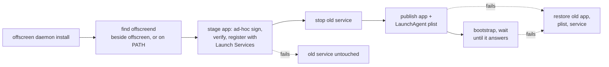
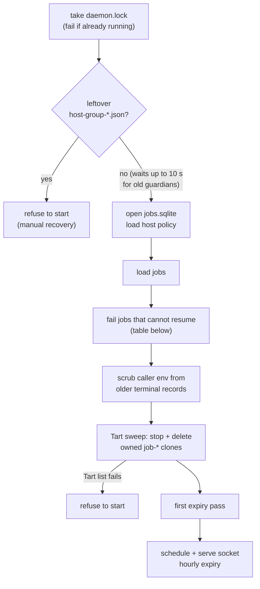
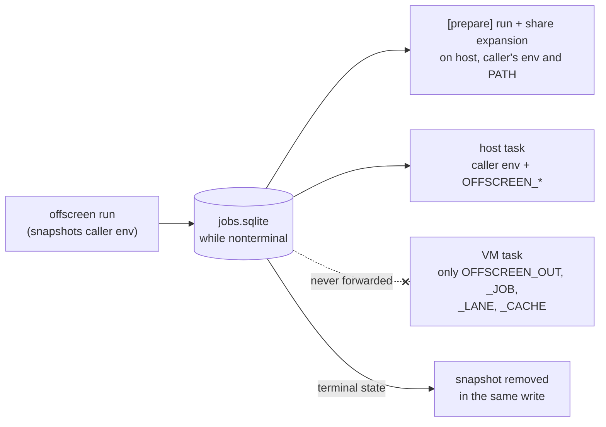
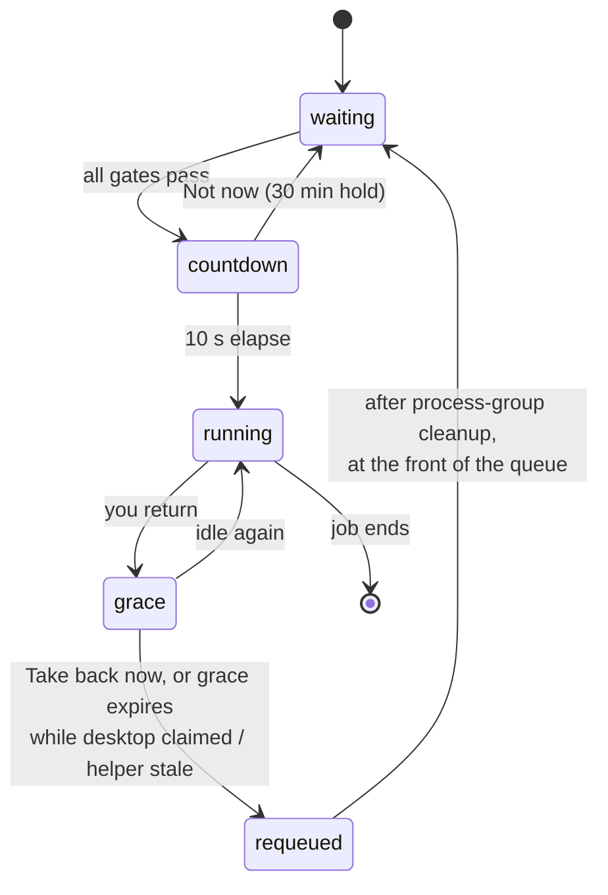
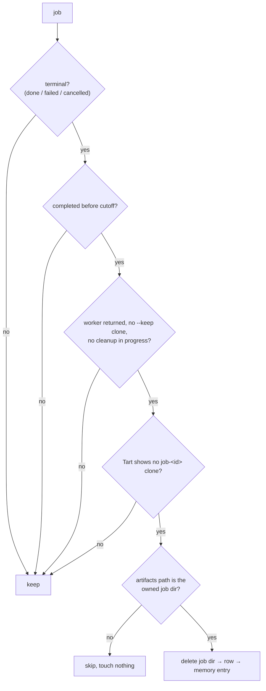

# Daemon operation

`offscreend` owns the job queue, both lanes, job history and cleanup. The CLI and the menu bar helper talk to it over an owner-only Unix socket. See [ARCHITECTURE.md](ARCHITECTURE.md) for how the pieces fit together.

## Files

| What | Default path | Notes |
| --- | --- | --- |
| Job database | `~/Library/Application Support/offscreen/jobs.sqlite` | Owner-only. Jobs plus the persisted host pause/Not now policy. |
| Socket | `~/Library/Application Support/offscreen/offscreend.sock` | Owner-only (`0600`). |
| Daemon app | `~/Library/Application Support/offscreen/OffscreenDaemon.app` | Bundle ID `dev.offscreen.offscreend`, `LSUIElement`. |
| Job output | `~/Library/Caches/offscreen/jobs/<id>/` | `stream.bin` (stdout/stderr) and artifacts. |
| Daemon log | `~/Library/Application Support/offscreen/daemon.log` | The daemon's stderr (`--log-level` / `OFFSCREEN_LOG_LEVEL`). |
| LaunchAgent | `~/Library/LaunchAgents/dev.offscreen.offscreend.plist` | `RunAtLoad` + `KeepAlive`. Not moved by `OFFSCREEN_STATE_DIR`. |
| Guardian markers | `host-group-*.json` in the state directory | Present only while a host job runs, or after a guardian crash. |

`OFFSCREEN_STATE_DIR` moves everything except the LaunchAgent. Keep it short, because Unix socket paths have a length limit. `OFFSCREEN_CONFIG` selects the user config.

## Install

- The LaunchAgent carries `OFFSCREEN_CONFIG`, `OFFSCREEN_STATE_DIR` (if set) and the installer's `PATH`, so launchd can find Tart.
- **Reinstall after rebuilding `offscreend`.**
- `offscreen daemon uninstall` stops the service and removes only its LaunchAgent plist. The bundle stays.
- `offscreen run` does not start a daemon on its own. Without the service it exits 70 and tells you to install it.
- Build an image (`offscreen image build`) before submitting jobs.

### Local Network permission

VM jobs reach the guest over SSH, which needs the daemon's Local Network permission. If macOS prompts, allow **Offscreen Daemon** in System Settings > Privacy & Security > Local Network.

| Symptom | Check |
| --- | --- |
| Guest SSH times out with "no route to host" | Local Network setting for Offscreen Daemon, then the Tart network. The error alone does not prove a denial. |
| Permission lost after rebuilding | Expected with ad-hoc signing. Grant it again. Only an Apple-issued signing identity keeps it across rebuilds. |

The helper's Input Monitoring and Notifications grants do not substitute for this permission.

## Startup and restart

What happens to a job that was in flight when the daemon stopped:

| State at shutdown | After restart |
| --- | --- |
| Queued, detached | Resumes after reloading its project contract. It sees any edits made to the contract since submission. |
| Queued, detached, contract unreadable | `failed` (70) |
| Queued, attached | `failed` (70). Its stdin attachment is gone, so it is not retried with empty input. |
| Preparing / running / collecting | `failed` (70), orphaned. Its clone is cleaned up. Its age for expiry starts now. |
| Retained `--keep` clone | Clone deleted by the sweep. |

A `job-*` clone counts as owned only if it matches a recorded job, or its 16-hex-digit ID has a job directory. Other tools' `job-*` VMs are left alone.

## Caller environment

- Each job keeps its own caller's environment, so clients can't affect each other's preparation. A requeued job, or one resumed after a restart, still runs with the right environment.
- The daemon's own environment controls Tart.
- **Active job records can contain secrets.** If the write that removes the snapshot fails, the daemon stops admission and does not report the job as finished.
- Removal is logical, not secure erasure. SQLite free pages, the journal, and any backups can keep old values until they are overwritten. Protect the state directory and its backups.

## Host lane

The host lane needs the [menu bar helper](helper/README.md). `offscreen pause` and `offscreen resume` work without it.

A job waits, with its reason shown in `offscreen status`, until all of these hold:

| Gate | Fails when |
| --- | --- |
| Helper | Absent, or heartbeat older than 3 s |
| Permissions | Input Monitoring or the event tap is unavailable |
| Session | Locked, or display asleep |
| Privacy | Camera or microphone in use |
| Idle | `idle_threshold` not reached |
| Policy | Paused, or a **Not now** hold is active |

- **Pause and Not now persist** in SQLite before they're acknowledged, and they survive restarts. `offscreen resume` clears both. A failed write stops admission.
- **On return:** a job that is still preparing stops at once, so it can't start a GUI task. A running job gets the `grace` period. At grace expiry it is also requeued if the desktop is still claimed or the helper's heartbeat is stale.
- **Requeued jobs get closed stdin.** Use detached host jobs if a task may be interrupted.
- `idle_threshold` and `grace` are read at startup. Restart the daemon after changing them.
- Automatic return detection is off until you run the [helper probe](helper/README.md) and enable `VerifiedInputFilter`. A permission denial is not evidence either way.

### Guardian recovery

Each host task runs under a guardian process. It writes an owner-only `host-group-*.json` marker before starting the command and removes the marker once cleanup of the process group is confirmed.

| Situation | Daemon behavior | What you do |
| --- | --- | --- |
| Guardian can't confirm cleanup | Stops admission and exits. The next start waits for the old guardian. | Nothing, unless it persists. |
| Guardian crashed, marker left | Refuses to start, even if the cleanup lock is free | Read the marker's command and process details. Make sure no task processes are left (check a process's identity before killing it; stored PIDs are hints only). Then delete the marker and restart. |

## Retained `--keep` clones

A failed VM job started with `--keep` keeps its clone, its VM slot (including the one-slot low-memory limit) and any exclusive-project lease. `offscreen status` shows when a retained clone is blocking the queue.

- `offscreen cancel <job>` deletes the clone and releases the leases. The recorded failure, exit code, logs and artifacts stay. You can safely repeat it; if Tart cleanup fails, the lease stays held until a retry succeeds.
- Stopping the VM yourself does **not** release the lease.

## Job history: expiry and prune

| | Automatic expiry | `offscreen prune` |
| --- | --- | --- |
| Cutoff | `job_retention` (default `168h`), read at startup | `--older-than <duration>`, positive |
| When | Once at startup before serving, then hourly | On demand; `--dry-run` previews, `--yes` applies, no prompt |
| Output | Counts on stderr (info at startup or after a deletion, otherwise debug) | stdout: cutoff, each `would-delete`/`deleted`/`skipped` job, summary |
| A deletion fails | Logged at warn; retried next pass | Reported on stderr, exits nonzero; rerun to retry |
| Tart can't be listed | Pass deletes nothing, logs an error | Deletes nothing, exits nonzero |

- Both use the same engine and never overlap. A failed delete never rewrites a job's completion time, and never stops the daemon.
- A cancelled `--keep` job keeps its original completion time.
- Never touched: per-project caches, golden images, VMs, and anything outside a job's own directory. Symlinks inside a job directory are removed, not followed.
- Freed SQLite pages are reused, so the database stays near its high-water size. It never shrinks (there is no routine `VACUUM`), and old pages, the journal and backups can still hold deleted data.
- Expiry runs only while the daemon is up. Old history from a long-stopped daemon is removed at its next startup.
