<h1>
  <picture>
    <source media="(prefers-color-scheme: dark)" srcset="docs/assets/header-dark.svg">
    
  </picture>
</h1>

[](https://github.com/markphelps/offscreen/actions/workflows/ci.yml)
[](LICENSE)

**Give your agents a Mac screen of their own. Offscreen runs UI tests, the iOS Simulator and GUI apps in throwaway VMs, so your desktop stays yours.**

When a coding agent runs XCUITest, boots the iOS Simulator, or launches the app it just built, it takes over your Mac: windows pop up, focus jumps, and you can't type until it finishes. Offscreen runs that work in a fresh macOS VM instead. Any number of agents, terminals and scripts share one queue, and each job gives you back logs, screenshots and `.xcresult` bundles.

> [!NOTE]
> Offscreen is beta software. Commands, config and on-disk state may change between versions. Please [open an issue](https://github.com/markphelps/offscreen/issues) if something breaks.

<picture>
  <source media="(prefers-color-scheme: dark)" srcset="docs/assets/how-it-works-dark.svg">
  
</picture>

## Quick start

You need an Apple silicon Mac with macOS 14 or later, full Xcode, and [Homebrew](https://brew.sh/).

Install Offscreen and build its VM image:

```sh
brew install --cask markphelps/tap/offscreen
                           # installs the CLI, the daemon, the Offscreen
                           # menu bar app and Tart
open -a Offscreen          # if macOS asks, allow "Offscreen Daemon" on the Local Network
offscreen image build      # one-time: pulls a macOS + Xcode image, takes a while, go grab lunch
```

The install also adds `ofs` as a shorter name for `offscreen`, so `ofs run hello test-ui` works too.

Then try it on the example app. The example lives in this repository, so clone it to get the project; you don't build Offscreen itself:

```sh
git clone https://github.com/markphelps/offscreen.git
cd offscreen/examples/hello
offscreen run hello test-ui
```

The last command builds a small SwiftUI app on your Mac, runs its UI test inside a fresh VM, streams the output, and prints the job's artifact directory. Nothing opens on your desktop. The same example has two more tasks: `offscreen run hello test-ios` runs the test in an iOS Simulator inside the VM, and `offscreen run hello launch` opens the app and saves a screenshot. For problems, see the [install guide](docs/install.md). It also covers [building from source](docs/install.md#build-from-source) if you'd rather not use Homebrew.

Offscreen has three parts: the `offscreen` CLI, the `offscreend` daemon that runs jobs, and the **Offscreen** menu bar app. The app owns the daemon: opening Offscreen starts it, and quitting Offscreen stops it. Its menu lists queued, running and recently finished jobs from both lanes, with Cancel, Reveal Artifacts and Copy Job ID for each, plus Restart Daemon and Quit Offscreen. If Offscreen isn't running, CLI commands say so: `Offscreen isn't running. Open it with: open -a Offscreen`.

## What you can run

Anything that needs a logged-in Mac desktop:

- **macOS UI tests.** XCUITest for Mac apps, with `.xcresult` bundles collected after each run.
- **iOS Simulator tests.** XCUITest against an iPhone simulator inside the VM; the hello example runs on the default image with no extra setup. A fresh VM boots the simulator from scratch, so expect a few minutes per run, or warm it once in the golden image ([hello example](examples/hello/README.md#offscreen-tasks)).
- **Launch and look.** Open the app your agent just built, drive it with AppleScript or System Events, and save screenshots for the agent (or you) to check.
- **One-off commands.** `offscreen run myapp -- <cmd>` runs any command in a fresh VM, no task definition needed.

## Use it in your repo

At the repo root, write a starter `.offscreen.toml`, fill it in, and check it:

```sh
ofs init     # writes .offscreen.toml with every section commented out
ofs check    # validates it and lists its tasks, without starting a VM
```

A filled-in contract looks like this:

```toml
project = "myapp"

[prepare]   # runs on your Mac before each job
run = "xcodebuild -scheme MyApp -derivedDataPath .build build"
share = [".build/Build/Products/Debug/MyApp.app"]

[tasks.ui]  # runs inside the VM
lane = "vm"
run = "sh scripts/ui-test.sh"
```

Then tell your agent to run this instead of `xcodebuild test` or launching the app itself:

```sh
offscreen run myapp ui
offscreen run myapp -- swift test   # or any one-off command
```

To teach your agent the rest (reading exit codes and artifacts, queuing long jobs, and what not to touch), install the [offscreen skill](skills/offscreen/SKILL.md):

```sh
npx skills add markphelps/offscreen      # add -g to install for all projects
```

Or, without the skill, add a line like this to your `AGENTS.md` or `CLAUDE.md`:

```md
Run UI tests with `offscreen run myapp ui`. Never run `xcodebuild test` directly; it takes over the user's screen.
```

`offscreen run` exits with the wrapped command's status, so agents and scripts read pass/fail the usual way. Offscreen's own failures use separate codes: 75 for a queue timeout, 70 for VM or daemon errors. Tasks write screenshots and results to `$OFFSCREEN_OUT`, and `offscreen artifacts <job>` prints where those ended up. The [config reference](docs/config.md) covers guest setup, caches and environment variables.

## How it compares

- **Running tests on your own desktop.** This works fine until a test or the Simulator opens a window while you're typing. Offscreen runs the same `xcodebuild` commands in a VM, so you keep working.
- **Running Tart yourself.** [Tart](https://github.com/cirruslabs/tart) is the VM layer offscreen uses. Offscreen adds the parts you'd otherwise script by hand: a per-job clone of a golden image, copying the worktree and build products in, collecting artifacts, cleaning up afterwards, and a single queue for every caller, capped at Apple's limit of two macOS VMs.
- **Hosted macOS CI** (GitHub Actions, Cirrus, and others). CI runs after you push. Offscreen runs locally whenever you or your agent call it, before you commit. It doesn't replace CI.

## Commands

| Command | What it does |
| --- | --- |
| `offscreen run <project> <task>` | Queue a named task, stream output, and wait for its result. |
| `offscreen run <project> -- <cmd>` | Run a one-off command in a VM. |
| `offscreen init` | Write a starter `.offscreen.toml` in the current directory. |
| `offscreen check` | Validate `.offscreen.toml` and list its tasks, without starting a VM. |
| `offscreen status` | List queued and active jobs; `-a` adds completed ones. |
| `offscreen logs <job>` | Print a job's output so far; `-f` follows it. |
| `offscreen artifacts <job>` | Print a job's artifact directory. |
| `offscreen cancel <job>` | Cancel a job and wait for cleanup. |

Useful `run` flags: `--detach` returns right away, `--keep` keeps a failed VM for inspection, `--show` opens the VM in a window so you can watch it, and `--timeout` limits how long a job can wait and run. See the [command reference](docs/cli.md) for all commands, flags, and exit codes.

## Jobs that need real hardware

Some checks can't run in a VM. A task with `lane = "host"` runs on your actual desktop, one job at a time, and only when you're idle: the screen must be unlocked and awake, the camera and microphone off, and you away for long enough. A countdown lets you say **Not now** first. If you come back mid-job, a notification lets you take the desktop back. The [Offscreen menu bar app](app/README.md) watches the desktop for this lane; it asks for Input Monitoring only once you queue a host job. Automatic return detection stays off until you check it on your Mac. Read [lanes and safety](docs/lanes.md) before turning it on.

## Built with Offscreen

I use Offscreen to develop and test my three macOS apps:

- [Cove](https://covereader.com): a local-first RSS reader that keeps the full articles you subscribe to.
- [Vigil](https://vigilmac.com): a menu bar app that keeps your Mac awake while coding agents work.
- [Ramble](https://ramblemac.com): point at something on screen and talk; your coding agent gets screenshots and a transcript.

## Learn more

- [Install guide](docs/install.md): Homebrew, building from source, upgrades, and permissions
- [Configuration](docs/config.md): project contract and user config
- [Command reference](docs/cli.md): every command, flag, and exit code
- [Lanes and safety](docs/lanes.md): how the VM and host lanes isolate work
- [Daemon operation](DAEMON.md): state, restarts, and cleanup
- [Architecture](ARCHITECTURE.md): components, job lifecycle, and invariants
- [Hello example](examples/hello/README.md): the sample app and its tasks
- [Contributing](CONTRIBUTING.md): developer checks and local end-to-end testing

## License

[MIT](LICENSE)
